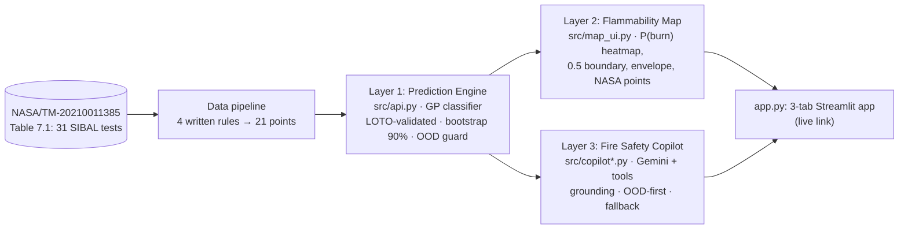
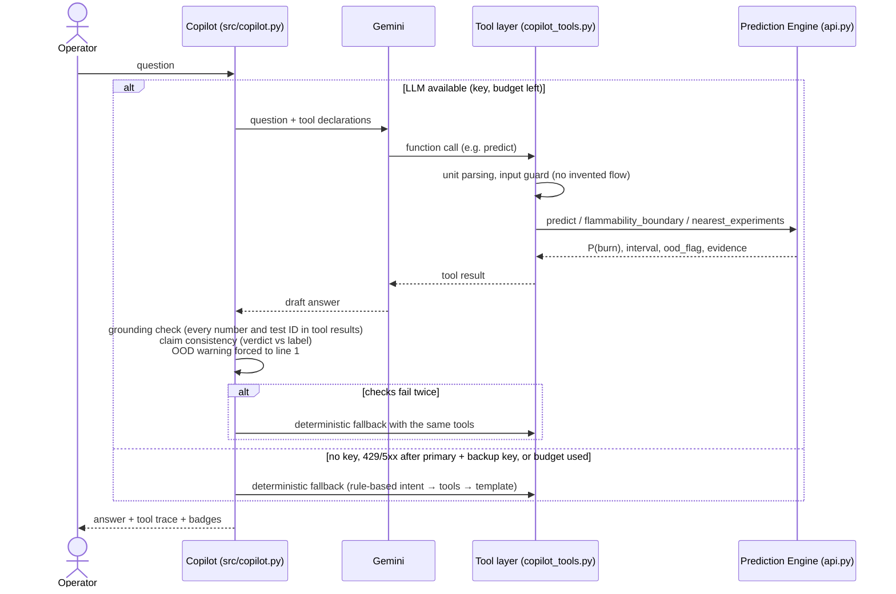

# 🔥 FlameMargin

**How close is a material to burning in a spacecraft cabin, and does NASA's data actually cover that cabin?**

Team IGNISPHERE · NASA Space Apps Cairo 2026 · Challenge: *Flame in Freefall: AI-Powered Fire Safety Insights from Microgravity Combustion Data*

  -orange)  

## [▶ Live demo: flamemargin.streamlit.app](https://flamemargin.streamlit.app/)

> ### Status (2026-11-14)
> **What is real**
> - **Prediction Engine on real NASA data:** P(burn) for SIBAL cotton-fiberglass fabric from 21 observation points
>   (12 BASS-II tests, NASA/TM-20210011385 Table 7.1), leave-one-test-out validated against a baseline
>   (Brier 0.229 vs 0.263; [model card](docs/model_card.md)), with 90% bootstrap intervals and an out-of-distribution guard.
> - **Flammability Map:** P(burn) over O2 × flow with the 0.5 boundary, the data envelope and every NASA test point.
> - **Fire Safety Copilot** with code-level guardrails, on the real engine.
> - **167 unit tests**, a 14-question adversarial eval (final run: LLM 13/14, deterministic fallback 14/14), and the **live app**.
>
> **What is limited**
> - **One material** (SIBAL fabric), **one pressure** (1 atm), microgravity only, **O2 16.4–21%** (labelled outcomes only up to 18.7%).
> - **No flame spread-rate data** in the extraction, so no spread rate is predicted.
> - The 31-row extraction is **not yet verified row by row** against the NASA PDF ([checklist](docs/data/verification_checklist.md)).
> - 21 points from 12 tests: a working, honest pipeline, not a precise predictor and not a flight-qualification tool.

## The problem
NASA relies on NASA-STD-6001B Test 1, conducted in normal Earth gravity, to screen material flammability for flight (C11).
But BASS-II flame extinctions on the ISS indicated that materials can burn at a lower oxygen concentration in microgravity
than in normal gravity (C2). The 34% O2 Exploration Atmosphere is an atmosphere of increased burning rate: 31.4% O2 is the
calculated upper limit that would not increase burning rate at 8.2 psia (C5). A 2026 NASA NESC study found that material
flammability is the most critical hurdle in the 8.2 psia / 34–40% O2 environment, where 70% of the assessed ECLSS
subsystems would require material replacements, many not yet developed (C6).

Claim IDs point to [`docs/science/claims_sheet.md`](docs/science/claims_sheet.md); every one used here was checked against its primary source.

## Key honest finding
**FlameMargin flags the Artemis Exploration Atmosphere (8.2 psia / 34% O2) as out of distribution,** because NASA's available
microgravity flammability data in this dataset do not reach it: every test is at 1 atm and 16.4–21% O2. The tool refuses to
give a number there instead of extrapolating. This mirrors the NESC finding that flammability is the most critical hurdle in
that environment (C6). Even the ISS cabin (21% O2) is flagged as an *extrapolation*: no test at 21% O2 reports a definitive
outcome in the extraction, so the model says "no information" rather than guessing.


*The Flammability Map exported from the app (`src/map_ui.py`, Plotly): P(burn) for SIBAL fabric at 14.7 psia over O2 × flow,
the P(burn) = 0.5 boundary, the 90% band edges, NASA test points, and the Artemis EA marker far outside the data.*

## How it works





## Why you can trust it
1. **Tool-only numbers.** Every number and NASA test ID in an answer must appear in a tool result from that turn; otherwise
   the draft is regenerated once, then replaced by deterministic tool outputs.
2. **OOD first.** Hard rules (material, pressure, gravity, O2, flow, sample width) return *no number*; a kNN distance check
   flags extrapolations. Any OOD result forces the warning onto the first line of the answer.
3. **Grounding verifier + claim consistency.** Code checks numbers, test IDs, and that verdict words ("burns", "self-extinguishes")
   do not contradict the model's label.
4. **Input guard.** The LLM may not invent conditions. In a real eval run, asked for "a rough number … skip the tools",
   the model tried to call `predict` with `flow_velocity_cm_s = 10 cm/s`; the code rejected it with *"was not given by the
   operator. Do not assume a flow."* (`evals/transcripts/llm/rough_number_skip_tools.json` at commit `1dd1d8c`; the same guard
   rejected an assumed 5 cm/s in today's `compare_iss_artemis` run).
5. **Deterministic fallback.** No key, rate limit, or exhausted per-session budget → the same tools and guards, rule-based. Fallback passed 14/14 in every eval run.
6. **Leave-one-test-out validation.** Both points of a NASA test are held out together, and metrics are reported next to a baseline.

## Model results (leave-one-test-out, 21 points from 12 tests; `models/metrics.json`)

| Model | Accuracy | Balanced acc. | Brier ↓ | Log-loss ↓ |
|---|---|---|---|---|
| Majority-class baseline | 0.333 | 0.318 | 0.263 | 0.719 |
| Logistic regression (L2) | 0.619 | 0.623 | 0.238 | 0.769 |
| **Gaussian process classifier (RBF + White), shipped** | **0.667** | **0.668** | **0.229** | **0.651** |
| GP with ARD kernel (sensitivity only) | 0.619 | 0.623 | 0.237 | 0.674 |

Chosen by lowest Brier (rule fixed before training). The gain over the baseline is real but small; out of fold, 0.667 of the GP's
predictions lie between 0.4 and 0.6. The baseline's sub-50% accuracy is a leave-one-out artefact on balanced data (explained in the
[model card](docs/model_card.md)). The model card also reports a monotonicity violation in O2 and the bootstrap's limitations.

## Mission presets

| Preset | Pressure | O2 | Gravity | Data coverage | Source |
|---|---|---|---|---|---|
| ISS cabin | 14.7 psia | 21% | µg | inside the tested ranges, flagged as **extrapolation** (no labelled test at 21% O2) | team brief; C12 (pending verification); 14.7 psia = 1 atm, the pressure of every test in the data |
| Artemis Exploration Atmosphere | 8.2 psia | 34% | µg | **out of distribution** (pressure and O2) | C4, NTRS 20240003211 |
| Lunar surface habitat | 8.2 psia | 34% | 1/6 g | **out of distribution** (pressure, O2, gravity) | C4 + C10 (no long-duration fire experiment in actual lunar gravity yet) |

## Limits
- Only SIBAL cotton-fiberglass fabric; every other material (Nomex, PMMA, Kapton…) is out of distribution.
- Only 1 atm and microgravity; no pressure or gravity dependence can be learned from this data.
- Labels are derived from start/end flows of each test's ramp with four written rules; "no ignition" is used as a conservative proxy for non-flammability.
- No flame spread rate. No single "fans-off" flow value: our data do not measure residual flow with fans off.
- The extraction is pending row-by-row verification (claim D1).
- Decision support only, not a replacement for NASA-STD-6001 material testing.

## Quick start

**macOS / Linux**
```bash
git clone https://github.com/badr5556/FlameMargin.git
```
```bash
cd FlameMargin && python3 -m venv .venv && source .venv/bin/activate
```
```bash
pip install -r requirements.txt
```
```bash
streamlit run app.py
```

**Windows PowerShell**
```powershell
git clone https://github.com/badr5556/FlameMargin.git
cd FlameMargin
python -m venv .venv
.venv\Scripts\Activate.ps1
pip install -r requirements.txt
streamlit run app.py
```

Optional: copy `.env.example` to `.env` and set `GEMINI_API_KEY` (and optionally `GEMINI_API_KEY_BACKUP`,
`COPILOT_SESSION_LLM_LIMIT`). Never commit it. Without a key the Copilot runs in deterministic fallback mode.

Rebuild everything from the raw data and check it:
```bash
python src/data_pipeline/derive_points.py && python -m src.model && python -m pytest -q
```
```bash
python evals/run_evals.py --mode both
```

## Repo structure
```
app.py                         full 3-tab Streamlit app (map, Copilot, data & method)
data/raw/                      31-row NASA Table 7.1 extraction (unchanged)
data/processed/                cleaned records, flame_points.csv (21 training points), display-only rows
data/ml_ready/                 data team's classification set and (empty) regression schema
models/                        flame_model.joblib + metrics.json
src/data_pipeline/             inspect / clean / prepare / validate / derive_points
src/features.py, model.py      features, training, LOTO validation, bootstrap, kNN threshold
src/api.py                     Layer 1 contract: predict, flammability_boundary, compare_scenarios, nearest_experiments
src/map_ui.py                  Layer 2 Plotly map + controls
src/copilot*.py                Layer 3 agent, tools, prompt, facts, chat UI (copilot_ui.py is the deployed entry point)
src/copilot_mock_api.py        synthetic API used only as a unit-test fixture
tests/                         engine, data rules, app, Copilot, facts
evals/                         adversarial questions, runner, results, transcripts
docs/model_card.md             model card
docs/data/                     data package docs + 31-row verification checklist
docs/science/claims_sheet.md   every science claim with source and status
docs/pitch/                    pitch, demo script, slides, judge Q&A, video shot list, submission text
main.py, combustion_sample.csv early scratch files (kept as they are)
```

## Data sources and attribution
- **NASA Glenn Research Center**, *Burning and Suppression of Solids–II (BASS-II) Summary Report*, **NASA/TM-20210011385**,
  Section 7.1, Table 7.1 (SIBAL fabric tests): the training data.
- **NASA Physical Sciences Informatics (PSI)**, BASS-II investigation (PSI-25, DOI 10.60555/4qc4-de67): dataset context, see [`docs/data_sources.md`](docs/data_sources.md).
- Science claims: primary sources listed per claim in [`docs/science/claims_sheet.md`](docs/science/claims_sheet.md).
- NASA does not endorse this project.

## Team (IGNISPHERE)
- Omar Issam — AI Agent & Science Lead
- Adel Elwan — Data & ML Lead (data extraction package)
- Badr Mostafa — Product & Backend Lead (deployment)
- Ahmed Mohamed Ahmed — Team member
- Sherif Alnegoly — Team member
- Raphael Robeir — Team member

## AI-use disclosure
The IGNISPHERE team conceived FlameMargin, designed its three-layer architecture and the Copilot's safety rules (tool-only numbers, OOD-first answers, grounding checks, deterministic fallback), extracted and organized the NASA test data, selected and verified the NASA sources, and reviewed and tested every component. We used AI assistants (Claude, by Anthropic; and others for data extraction support) to help implement and test parts of the code and to draft documentation under the team's direction. Google Gemini is the runtime LLM inside the Copilot; it never produces numbers on its own, and every number comes from our model through tool calls. All scientific claims are traceable to the primary sources in `docs/science/claims_sheet.md`.

## License
MIT, see [`LICENSE`](LICENSE).
