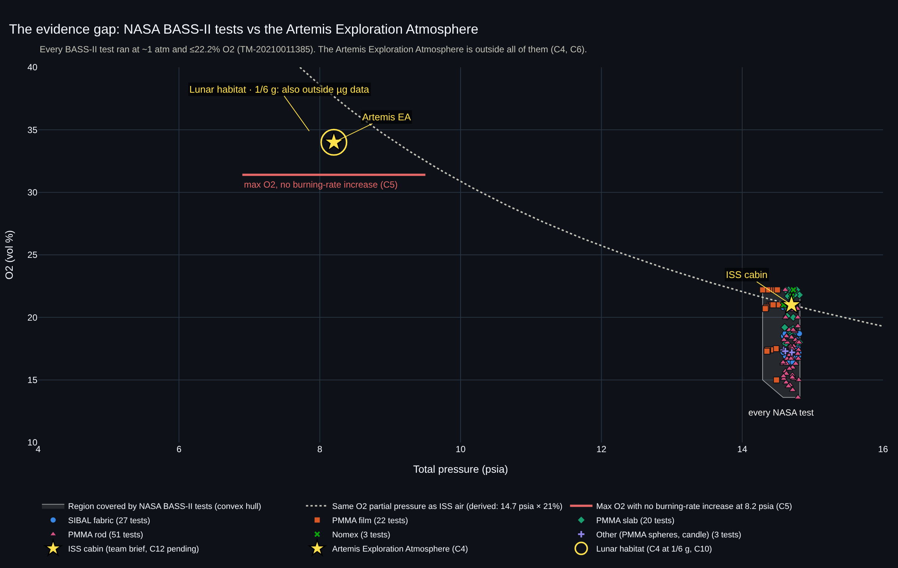
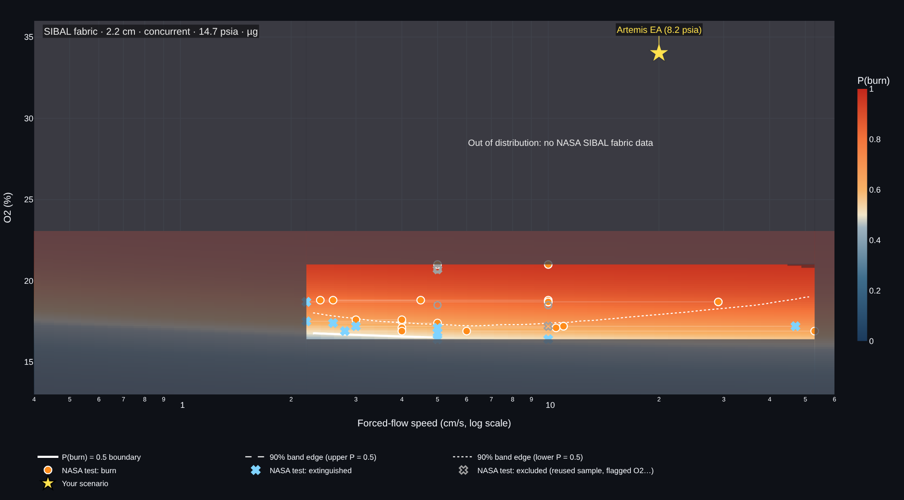
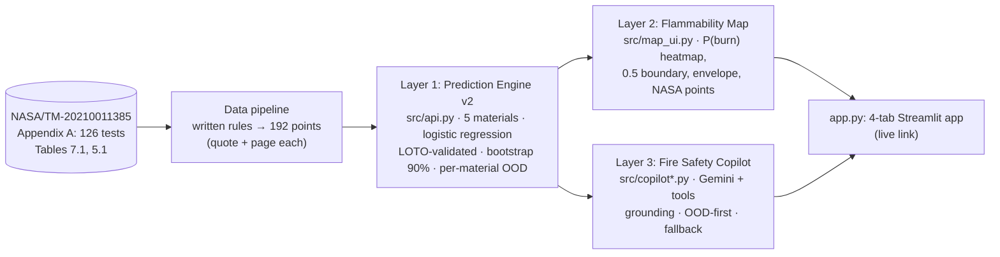
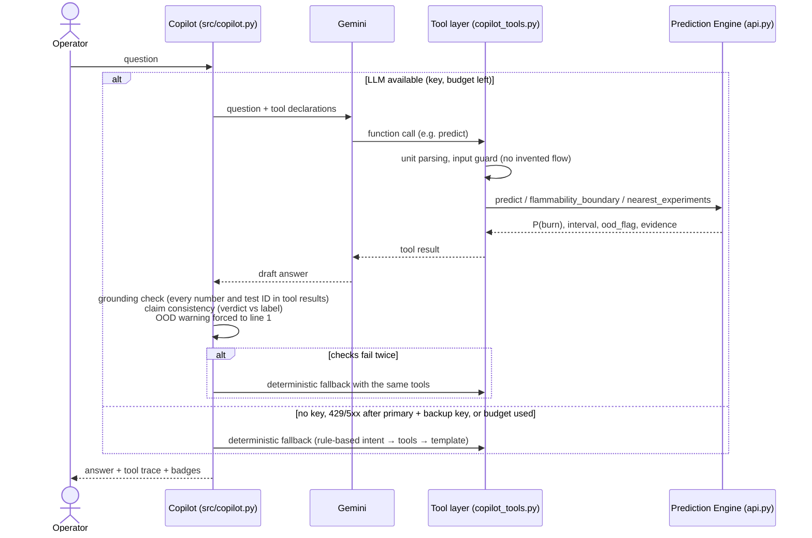

# 🔥 FlameMargin

**How close is a material to burning in a spacecraft cabin, and does NASA's data actually cover that cabin?**

Team IGNISPHERE · NASA Space Apps Cairo 2026 · Challenge: *Flame in Freefall: AI-Powered Fire Safety Insights from Microgravity Combustion Data*

  -orange)  

## [▶ Live demo: flamemargin.streamlit.app](https://flamemargin.streamlit.app/)

> ### Status (2026-11-14, engine v2)
> **What is real**
> - **All 126 BASS-II tests transcribed** from NASA/TM-20210011385 Appendix A (Tables A.1–A.6), every row compared with the PDF;
>   an independent 20% re-check with a second extractor passed 26/26 rows; the SIBAL Table 7.1 rows match Zhao et al. 2015 (31/31).
> - **Prediction Engine v2 on real NASA data:** P(burn) for **five materials** (SIBAL fabric, PMMA film, PMMA slab, PMMA rod, Nomex)
>   from **192 labelled points from 85 tests**, each with a verbatim quote and page from the report. Leave-one-test-out Brier
>   **0.087 vs 0.118** for the baseline, a Brier skill of **+26%** (AUC 0.82; [model card](docs/model_card.md)), 90% bootstrap intervals, per-material OOD guard.
> - **ISS air (21% O2) is now inside the data** for SIBAL fabric, PMMA film, PMMA slab and Nomex near its tests. The Artemis
>   Exploration Atmosphere stays **out of distribution for every material**.
> - **Flame spread rate for PMMA slabs** from Table 5.1 (39 measured rates, LOTO RMSE 0.175 vs 0.269 log10 units for the baseline).
> - **Flammability Map** per material, the **Fire Safety Copilot** with code-level guardrails, unit tests, a 15-question
>   adversarial eval and the **live app**.
>
> **What is limited**
> - **1 atm and ISS microgravity only**: no pressure or gravity dependence can be learned from BASS-II.
> - PMMA film points are all burns and Nomex points all non-sustained: for those the model repeats the tests, it cannot locate a
>   boundary. PMMA rods were tested only up to 20.8% O2.
> - On SIBAL's own v1 points v2 is worse than v1 (Brier 0.269 vs 0.229): its flow terms are shared by all materials.
> - Decision support, not a precise predictor and not a flight-qualification tool.

## The problem
NASA relies on NASA-STD-6001B Test 1, conducted in normal Earth gravity, to screen material flammability for flight (C11).
But BASS-II flame extinctions on the ISS indicated that materials can burn at a lower oxygen concentration in microgravity
than in normal gravity (C2). The 34% O2 Exploration Atmosphere is an atmosphere of increased burning rate: 31.4% O2 is the
calculated upper limit that would not increase burning rate at 8.2 psia (C5). A 2026 NASA NESC study found that material
flammability is the most critical hurdle in the 8.2 psia / 34–40% O2 environment, where 70% of the assessed ECLSS
subsystems would require material replacements, many not yet developed (C6).

Claim IDs point to [`docs/science/claims_sheet.md`](docs/science/claims_sheet.md); every one used here was checked against its primary source.

## Key honest finding

*The Evidence Gap view (first tab of the app, `src/evidence_gap.py`): all 126 BASS-II tests at their pressure and calibrated
initial O2, coloured by material, against the ISS cabin, the Artemis Exploration Atmosphere (C4) and the lunar habitat (C4 at
1/6 g, C10). Red segment: the calculated upper O2 limit with no burning-rate increase at 8.2 psia (C5). Dotted curve: the same
O2 partial pressure as ISS air (derived arithmetic, 14.7 psia × 21%). Pressure is plotted at the 99.2–99.5 kPa range measured
for the Bhattacharjee tests (p. 38) and at 1 atm otherwise (stated p. 94 for T'ien, assumed for the other PIs); points carry a
small x jitter for visibility. Every BASS-II test ran at ~1 atm and ≤22.2% O2 (TM-20210011385). The Artemis Exploration
Atmosphere is outside all of them (C4, C6).*

**FlameMargin flags the Artemis Exploration Atmosphere (8.2 psia / 34% O2) as out of distribution for every material,**
because no BASS-II test reaches it: all 126 tests ran at 1 atm (stated for the T'ien tests, p. 94; 99.2–99.5 kPa measured in the
Bhattacharjee tests, p. 38) with calibrated initial O2 from 13.6% to 22.2%. The tool refuses to give a number there instead of extrapolating. This mirrors
the NESC finding that flammability is the most critical hurdle in that environment (C6). With all 126 tests in, the ISS cabin
(21% O2) is now inside the data for four of the five materials, and NASA's own words back the result: two SIBAL tests at 21% O2
reached steady spread (p. 95), and three Nomex III tests in concurrent flow at 21–22.2% O2 ignited only briefly and did not
sustain a flame (F1, F2, F3; Table A.2, p. 105; claim D3).


*The Flammability Map exported from the app (`src/map_ui.py`, Plotly): P(burn) for SIBAL fabric (2.2 cm, concurrent) at 14.7 psia
over O2 × flow, the P(burn) = 0.5 boundary, the 90% band edges, every SIBAL NASA point (hover: test, PI, outcome, quote, page),
excluded points in grey, and the Artemis EA marker far outside the data. The app has the same view for all five materials.*

## How it works





## Why you can trust it
1. **Tool-only numbers.** Every number and NASA test ID in an answer must appear in a tool result from that turn; otherwise
   the draft is regenerated once, then replaced by deterministic tool outputs.
2. **OOD first.** Hard rules (material, pressure, gravity, flow configuration, and O2 / flow / thickness / size outside *that
   material's* tested ranges) return *no number*; a kNN distance check against the same material's tests flags extrapolations.
   Any OOD result forces the warning onto the first line of the answer.
3. **Grounding verifier + claim consistency.** Code checks numbers, test IDs, and that verdict words ("burns", "self-extinguishes")
   do not contradict the model's label.
4. **Input guard.** The LLM may not invent conditions. In a real eval run, asked for "a rough number … skip the tools",
   the model tried to call `predict` with `flow_velocity_cm_s = 10 cm/s`; the code rejected it with *"was not given by the
   operator. Do not assume a flow."* (`evals/transcripts/llm/rough_number_skip_tools.json` at commit `1dd1d8c`; the same guard
   rejected an assumed 5 cm/s in today's `compare_iss_artemis` run).
5. **Deterministic fallback.** No key, rate limit, or exhausted per-session budget → the same tools and guards, rule-based. Fallback passed 15/15 in all three v2 eval runs.
6. **Leave-one-test-out validation.** Every point of a NASA test is held out together, and metrics are reported next to a baseline,
   per material, with a calibration table and a leave-one-material-out stress test.
7. **Traceable data.** Every training point carries the rule that made it, a verbatim quote that the tests check is an exact
   substring of the report text, and its page. No value is read off a figure.

## Model results (leave-one-test-out; `models/metrics_v2.json`, history in `models/metrics_history.json`)

**v2: 192 points from 85 tests, five materials**

| Model | Accuracy | Balanced acc. | Brier ↓ | Log-loss ↓ | AUC¹ |
|---|---|---|---|---|---|
| Prior baseline | 0.865 | 0.500 | 0.118 | 0.401 | 0.061 |
| **Logistic regression (L2, O2 × material), shipped** | **0.891** | **0.612** | **0.087** | **0.306** | **0.820** |
| Gaussian process classifier | 0.865 | 0.500 | 0.117 | 0.398 | 0.100 |
| Gradient boosting (monotone in O2) | 0.870 | 0.568 | 0.100 | 0.340 | 0.775 |

¹ Prior baseline and GP are near-constant predictors under leave-one-test-out; their AUC is degenerate (<0.5) because the held-out test shifts the training prior. Compare on Brier and log-loss.

**Before / after**

| | Data | Shipped model | LOTO Brier (baseline) |
|---|---|---|---|
| v1 | 21 SIBAL points, 12 tests (Table 7.1) | GP | 0.229 (0.263) |
| v2 | 192 points, 85 tests, 5 materials (Appendix A + Tables 7.1, 5.1) | logistic regression | 0.087 (0.118) |
| v2 on the same 21 v1 points | | logistic regression | 0.269 (0.369) |

Chosen by lowest Brier (rule fixed before training). Accuracy is not informative here (86% of the points are burns). No model
decreases P(burn) as O2 rises (0 of 18 O2 curves). **Honest reading:** v2 is the broader, better-verified screen, but on SIBAL's
own v1 points it is worse than v1, because its flow terms are shared by all materials and cannot bend into SIBAL's low-flow
quenching branch. Per-material results, calibration, the stress test and this limit are in the [model card](docs/model_card.md).

## Mission presets (at 10 cm/s; `src/api.py`)

| Preset | Pressure | O2 | Gravity | SIBAL fabric | PMMA film | PMMA slab | PMMA rod | Nomex | Source |
|---|---|---|---|---|---|---|---|---|---|
| ISS cabin | 14.7 psia | 21% | µg | in distribution, burn (P 0.96) | in distribution, burn | in distribution, burn (P 0.93) | **OOD** (tested ≤ 20.8% O2) | in distribution, no sustained flame (P 0.02) | team brief; C12 (pending verification) |
| Artemis Exploration Atmosphere | 8.2 psia | 34% | µg | **OOD** | **OOD** | **OOD** | **OOD** | **OOD** | C4, NTRS 20240003211 |
| Lunar surface habitat | 8.2 psia | 34% | 1/6 g | **OOD** | **OOD** | **OOD** | **OOD** | **OOD** | C4 + C10 |

## Limits
- Five BASS-II materials only; Kapton, Teflon or any other material is out of distribution.
- Only 1 atm and microgravity; no pressure or gravity dependence can be learned from this data.
- Labels come from written rules applied to the crew's observations and the PI tables; 55 of the 192 training points are
  medium-confidence. Film and rod extinctions mostly happened at fan-potentiometer settings with no cm/s value, so those
  families are almost all burn points; Nomex has three non-sustained points only.
- Spread rate only for PMMA slabs (Table 5.1). No single "fans-off" flow value: our data do not measure residual flow with fans off.
- Decision support only, not a replacement for NASA-STD-6001 material testing.

## Quick start

**macOS / Linux**
```bash
git clone https://github.com/badr5556/FlameMargin.git
```
```bash
cd FlameMargin && python3 -m venv .venv && source .venv/bin/activate
```
```bash
pip install -r requirements.txt
```
```bash
streamlit run app.py
```

**Windows PowerShell**
```powershell
git clone https://github.com/badr5556/FlameMargin.git
cd FlameMargin
python -m venv .venv
.venv\Scripts\Activate.ps1
pip install -r requirements.txt
streamlit run app.py
```

Optional: copy `.env.example` to `.env` and set `GEMINI_API_KEY` (and optionally `GEMINI_API_KEY_BACKUP`,
`COPILOT_SESSION_LLM_LIMIT`). Never commit it. Without a key the Copilot runs in deterministic fallback mode.

Rebuild everything from the raw data and check it:
```bash
python -m src.data_pipeline.extract_appendix_a && python -m src.data_pipeline.derive_points_v2 && python -m src.spread_rate && python -m src.model_v2 && python -m pytest -q
```
```bash
python evals/run_evals.py --mode both
```

## Repo structure
```
app.py                         full 4-tab Streamlit app (evidence gap, map, Copilot, data & method)
data/raw/                      bass2_appendix_a_tests.csv (126 tests), source/ snapshots of the PDF text, v1 Table 7.1 extraction
data/processed/                flame_points_v2.csv (215 points, 192 for training), spread_rates_v1.csv (39), v1 files
models/                        flame_model_v2.joblib, metrics_v2.json, metrics_history.json, spread_rate_v1.json; v1 artifact + metrics.json
src/data_pipeline/             extract_appendix_a, report_tables, derive_points_v2, double_check_catalog, crosscheck_zhao2015 (+ v1 scripts)
src/model_v2.py                features, 4 models, LOTO, calibration, stress test, bootstrap, per-material OOD
src/spread_rate.py             PMMA-slab spread-rate model (Table 5.1)
src/api.py                     Layer 1 contract: predict, flammability_boundary, compare_scenarios, nearest_experiments
src/evidence_gap.py            Evidence Gap view: all 126 tests in pressure x O2 vs the mission atmospheres
src/map_ui.py                  Layer 2 Plotly map + controls (material, thickness, size, configuration)
src/copilot*.py                Layer 3 agent, tools, prompt, facts, chat UI (copilot_ui.py is the deployed entry point)
src/features.py, model.py      v1 engine (kept for the before/after comparison)
tests/                         catalog, labelling rules, engine, app, Copilot, facts
evals/                         adversarial questions, runner, results, transcripts
docs/model_card.md             model card v2
docs/data/                     extraction audit, data dictionary v2, 20% double-check, v1 data package docs
docs/science/claims_sheet.md   every science claim with source and status
docs/pitch/                    pitch, demo script, slides, judge Q&A, video shot list, submission text
main.py, combustion_sample.csv early scratch files (kept as they are)
```

## Data sources and attribution
- **NASA Glenn Research Center**, *Burning and Suppression of Solids–II (BASS-II) Summary Report*, **NASA/TM-20210011385**:
  training data from 85 tests / 192 points, Appendix A (Tables A.1–A.6), Table 7.1 and Table 5.1; SIBAL rows cross-checked
  against Zhao, T'ien, Ferkul, Olson 2015 (NTRS 20150008962), 31/31 match (claim D1).
- **NASA Physical Sciences Informatics (PSI)**, BASS-II investigation (PSI-25, DOI 10.60555/4qc4-de67): dataset context, see [`docs/data_sources.md`](docs/data_sources.md).
- Science claims: primary sources listed per claim in [`docs/science/claims_sheet.md`](docs/science/claims_sheet.md).
- NASA does not endorse this project.

## Team (IGNISPHERE)
- Omar Issam — AI Agent & Science Lead
- Adel Elwan — Data & ML Lead (data extraction)
- Badr Mostafa — Product & Backend Lead (data extraction, deployment)
- Ahmed Mohamed Ahmed — Team member
- Sherif Alnegoly — Team member
- Raphael Robeir — Team member

## AI-use disclosure
The IGNISPHERE team conceived FlameMargin, designed its three-layer architecture and the Copilot's safety rules (tool-only numbers, OOD-first answers, grounding checks, deterministic fallback), extracted and organized the NASA test data, selected and verified the NASA sources, and reviewed and tested every component. We used AI assistants (Claude, by Anthropic; and others for data extraction support) to help implement and test parts of the code and to draft documentation under the team's direction. Google Gemini is the runtime LLM inside the Copilot; it never produces numbers on its own, and every number comes from our model through tool calls. All scientific claims are traceable to the primary sources in `docs/science/claims_sheet.md`.

## License
MIT, see [`LICENSE`](LICENSE).
