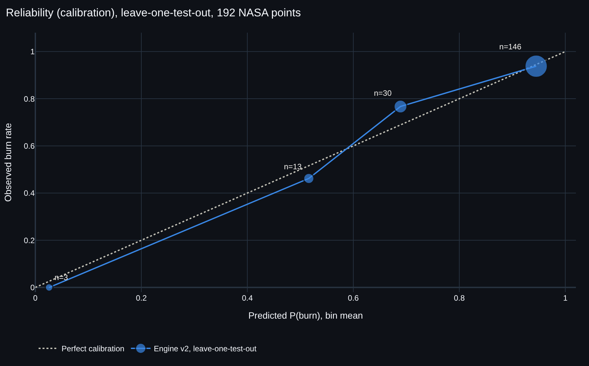

# Model card: FlameMargin Prediction Engine v2 (Layer 1)

> **Proof of pipeline on real NASA data, not a flight-qualification tool.**
> Every number here comes from `models/metrics_v2.json` (written by `python -m src.model_v2`), `models/metrics_history.json`,
> `models/spread_rate_v1.json` (written by `python -m src.spread_rate`) or the data files named below.
> v1 (SIBAL only, 21 points) is kept unchanged in `models/metrics.json` for the before/after table.
> **In production: v2** (logistic regression). **v2.1** (v2 + a pre-registered per-material flow shape for SIBAL fabric and
> PMMA slab, section 5b) is a documented experiment that **did not beat v2**: unrounded LOTO Brier 0.08710 vs 0.08657,
> log-loss 0.320 vs 0.306, AUC 0.803 vs 0.820. Both are reported throughout.

## 1. What it predicts
- **P(burn)**: the probability that a flame is sustained, for five BASS-II material families, at a given O2 and forced-flow speed,
  in ISS microgravity at 1 atm, with a 90% interval.
- **Flame spread rate (mm/s)** for **PMMA slabs only**, inside the Table 5.1 ranges (section 9). Every other material or condition
  returns `spread_rate_mm_s = None` with the reason.

| Material (API name) | Family | Geometry / flow tested | Points (burn / extinguished) | Tests | O2 tested | Flow tested |
|---|---|---|---|---|---|---|
| SIBAL fabric | SIBAL_fabric | 0.32 mm fabric, 1.2 / 2.2 cm wide, concurrent | 31 (21 / 10) | 19 | 16.4–21.0% | 2.2–53 cm/s |
| PMMA film | PMMA_film | 0.1–0.4 mm, 1 / 2 cm wide, opposed | 27 (27 / 0) | 13 | 17.3–22.2% | 1–10 cm/s |
| PMMA slab | PMMA_slab | 1–5 mm, 1.2 / 2.2 cm wide, opposed | 81 (70 / 11) | 19 | 16.8–22.2% | 1–21 cm/s |
| PMMA rod | PMMA_rod | 6.35–12.7 mm diameter, opposed / concurrent / stagnation | 50 (48 / 2) | 31 | 14.5–20.8% | 0.5–22 cm/s |
| Nomex | Nomex | Nomex III fabric, concurrent | 3 (0 / 3) | 3 | 21.0–22.2% | 8–15 cm/s |

## 2. Data
| Item | Value |
|---|---|
| Source | NASA/TM-20210011385 (BASS-II Summary Report, 2021): Appendix A Tables A.1–A.6 (pp. 103–113), Table 7.1 (p. 96), Table 5.1 (p. 57) |
| Catalog | **126 tests** (`data/raw/bass2_appendix_a_tests.csv`), as-run numbers 1–126, matching "A total of 126 tests were conducted as part of BASS–II" (p. 3) |
| Verification | all 126 rows compared with the PDF page images; independent 20% re-check with a second extractor: 26/26 (`docs/data/double_check_v2.md`); Table 7.1: 31/31 rows match the v1 extraction and 31/31 match Zhao et al. 2015 (NTRS 20150008962) |
| Labelled points | **215** (`data/processed/flame_points_v2.csv`); **192 used for training, from 85 tests** (166 burn, 26 extinguished; 137 high-, 55 medium-confidence) |
| Not used for training | 23 points kept for display: reused samples (16), spherical sections (5), NASA O2 footnote (2) |
| O2 | calibrated O2 (daily MCA offset, p. 6): initial for burn points, final for extinction points; SIBAL: Table 7.1 |
| Pressure / gravity | 1 atm (stated p. 94; 99.2–99.5 kPa p. 38; assumed for the other PIs) / ISS microgravity |
| Figures | **no value is read off a figure** |

### Labelling rules (one name per case, stored per point in `derivation_rule`; full list in `docs/data/extraction_audit.md` §B)
| Rule | burn | Confidence | Training points |
|---|---|---|---|
| `stated_burning_at_flow` | 1 | high | 60 |
| `table_5_1_spread_rate_at_flow` | 1 | high | 39 |
| `stated_extinction_at_flow` | 0 | high (1 medium) | 15 |
| `no_sustained_ignition` | 0 | high | 6 |
| `no_blowoff_at_max` | 1 | high | 3 |
| `hedged_burning` | 1 | medium | 4 |
| `flame_present_before_ramp` (added; same logic as v1 R1/R2) | 1 | medium | 49 |
| `text_reports_steady_spread__unique_condition_match` (GMT96-T7/T8, p. 95) | 1 | high | 2 |
| SIBAL v1 rules (`v1_flame_before_ramp`, `v1_quenched_end`, `v1_no_ignition`) | 1 / 0 / 0 | high | 9 / 4 / 1 |

Exclusions (kept for display): reused or reburned samples (same sample number used again, or Table 7.1 "Reused"), unknown flow
configuration ("?"), candle and spherical-section tests, points without a cm/s value (pot settings are never converted),
flagged O2, hardware-only observations, and two internally contradictory tests (O18, M12).

## 3. Features
`o2_pct`, `log10_flow`, `log10_flow_sq`, `log10_thickness` (0 when unknown) + `thickness_missing`, `size_z` (width for flat
samples, diameter for rods, standardized within each family), material one-hot (5), configuration one-hot (3).
The logistic regression also gets `o2 × material` interaction terms. All features are standardized inside the pipelines.

## 4. Models and validation
Leave-one-test-out (`LeaveOneGroupOut` grouped by `test_id`; every point of a test is held out together), 192 points.
Model settings were fixed before training; nothing was tuned on these folds.

| Model | Accuracy | Balanced acc. | Brier ↓ | Log-loss ↓ | AUC¹ |
|---|---|---|---|---|---|
| Prior baseline (training class rate) | 0.865 | 0.500 | 0.118 | 0.401 | 0.061 |
| **Logistic regression (L2, o2 × material) = v2** ← in production | **0.891** | **0.612** | **0.087** | **0.306** | **0.820** |
| Gaussian process classifier (RBF + White) | 0.865 | 0.500 | 0.117 | 0.398 | 0.100 |
| Gradient boosting (depth ≤ 3, monotone ↑ in O2) | 0.870 | 0.568 | 0.100 | 0.340 | 0.775 |
| v2.1 experiment: logistic regression + per-material flow shape (pre-registered, section 5b), not shipped | 0.891 | 0.612 | 0.087 | 0.320 | 0.803 |

¹ Prior baseline and GP are near-constant predictors under leave-one-test-out; their AUC is degenerate (<0.5) because the held-out test shifts the training prior. Compare on Brier and log-loss.

- **Selection rule (fixed before training):** lowest LOTO Brier among the v2 candidates → logistic regression, 0.087 vs baseline
  0.118, a Brier skill score of 1 − 0.087 / 0.118 = **+26%** (shown in the app header, computed from `metrics_v2.json`). Then the
  pre-registered v2.1 rule (section 5b): ship v2.1 only if its Brier is ≤ v2's, compared unrounded. v2.1 is 0.08710 vs v2's
  0.08657, so v2 stays in production. The header AUC (0.82) is v2's.
- **Accuracy is not informative here:** 86% of the points are burns, so "always burn" is 0.865 accurate. Read Brier, log-loss and AUC.
- The GP collapses to the prior (its AUC 0.100 is no better than the baseline's 0.061 ordering), because one isotropic length
  scale over 13 standardized dimensions, most of them one-hots, does not fit; it is reported, not shipped.

### Per material (production v2 and the v2.1 experiment vs baseline, out of fold)
| Material | n | Brier v2 | Brier v2.1 | Brier baseline | AUC v2 | AUC v2.1 | Note |
|---|---|---|---|---|---|---|---|
| SIBAL fabric | 31 | 0.208 | 0.204 | 0.256 | 0.648 | 0.681 | the only family with a two-sided flow boundary (quench and blowoff) |
| PMMA slab | 81 | 0.097 | 0.100 | 0.118 | 0.744 | 0.744 | the family with the most extinctions (11) |
| PMMA rod | 50 | 0.046 | 0.047 | 0.048 | 0.271 | 0.240 | 2 extinctions only: no real signal |
| PMMA film | 27 | 0.000 | 0.000 | 0.019 | n/a | n/a | every point is a burn |
| Nomex | 3 | 0.001 | 0.001 | 0.755 | n/a | n/a | every point is non-sustained; learned from the other 2 Nomex tests |

### Calibration (reliability table, production v2, out of fold)
| Predicted P(burn) | n | Mean predicted | Observed burn rate |
|---|---|---|---|
| 0.0–0.2 | 3 | 0.026 | 0.000 |
| 0.2–0.4 | 0 | – | – |
| 0.4–0.6 | 13 | 0.516 | 0.462 |
| 0.6–0.8 | 30 | 0.689 | 0.767 |
| 0.8–1.0 | 146 | 0.945 | 0.938 |

Mean predicted 0.861 vs observed 0.865. The model is reasonably calibrated where it has data; the 0.6–0.8 bin is under-confident.
(The v2.1 experiment's table: 3 / 0 / 18 / 26 / 145 points with observed rates 0.000 / – / 0.500 / 0.769 / 0.945.)

### Safety operating point (`models/safety_operating_point.json`, written by `python -m src.safety_eval`)
For fire safety the costly error is a **missed burn** (calling a condition *won't burn* where NASA saw a flame). On the shipped
model's leave-one-test-out P(burn), 192 points (166 burn, 26 extinguished):

| Threshold on P(burn) | Burn recall | Missed burns | False-*safe* rate | *Won't burn* calls | Extinguished recall |
|---|---|---|---|---|---|
| **0.50** (the verdict the readout uses) | 0.994 | 1 of 166 | 0.143 | 7 | 0.231 |
| 0.63 (largest with burn recall ≥ 0.95) | 0.952 | 8 of 166 | 0.444 | 18 | 0.385 |

Burn recall = share of burn points called *burn*; false-*safe* rate = share of *won't burn* calls that were burns; extinguished
recall = share of extinguished points called *won't burn*. **The readout keeps 0.5** (verdict logic unchanged; an exact tie
counts as burn): it already exceeds the 0.95 recall target, and the largest threshold that still meets the target (0.63)
would miss 8 burns instead of 1. The price is that the model rarely says *won't burn*: only
7 of 192 points, and 23% of the NASA extinctions. The map readout states the threshold and its miss count.

### Reliability plot


*Out-of-fold P(burn) of the shipped model binned by 0.2 (bin counts on the markers; same numbers as the table above).*

### Stress test: leave-one-material-family-out (reported only, not used for selection)
| Held-out family | Brier v2 | AUC v2 | Brier v2.1 | AUC v2.1 |
|---|---|---|---|---|
| SIBAL fabric | 0.315 | 0.633 | 0.316 | 0.633 |
| PMMA film | 0.001 | n/a | 0.004 | n/a |
| PMMA slab | 0.124 | 0.697 | 0.120 | 0.719 |
| PMMA rod | 0.704 | 0.740 | 0.668 | 0.708 |
| Nomex | 0.996 | n/a | 0.996 | n/a |

**What it means:** the model does **not** transfer to an unseen material. Without rod data it calls rods non-flammable
(Brier 0.704 for v2; 0.668 for the v2.1 experiment); without Nomex data it calls Nomex flammable (0.996). That is exactly why any material outside the five is a hard OOD.

### Monotonicity in O2
On 18 O2 curves (each family × tested configuration × 10th/50th/90th-percentile flow), **no model decreases** as O2 rises
(v2 0 / 18, v2.1 0 / 18, GP 0 / 18, boosting 0 / 18 by construction). v1's GP violated it (`models/metrics.json`).

### Sensitivity: high-confidence points only
v2 trained and scored on the 137 high-confidence points: Brier 0.116, AUC 0.802; trained on high + medium and scored on the
same 137 points: Brier 0.109, AUC 0.813. The v2.1 experiment: 0.117 / 0.781 (high only) and 0.109 / 0.796 (high + medium). Adding the 55 medium points does not hurt the
high-confidence points.

## 5. Before / after (v1 → v2), `models/metrics_history.json`
| | Points / tests | Materials | Shipped model | LOTO Brier | Baseline Brier |
|---|---|---|---|---|---|
| v1 | 21 / 12 | SIBAL | GP | 0.229 | 0.263 |
| v2 | 192 / 85 | 5 families | logistic regression | 0.087 | 0.118 |
| v2 scored on the same 21 v1 points | 21 | SIBAL | logistic regression | **0.269** | 0.369 |
| v2.1 experiment (not shipped) | 192 / 85 | 5 families | logistic regression + per-material flow shape | 0.087 (0.08710 vs v2's 0.08657) | 0.118 |
| v2.1 experiment on the same 21 v1 points | 21 | SIBAL | v2.1 | 0.258 | 0.369 |

**Honest reading:** v2 is a much broader and better-verified screen (5 materials, ISS O2 covered for 4 of them), and it beats
its baseline overall. **On SIBAL's own v1 points it is worse than v1 (0.269 vs 0.229).** The cause is structural: the flow terms
are shared by all materials, so the model cannot bend into SIBAL's low-flow quenching branch (it gives P(burn) 0.78 at 18.7% O2
and 2.2 cm/s, where GMT45-T4 quenched). The boosting model does better on SIBAL (Brier 0.187 on the 31 SIBAL points) but worse
overall (0.100), and the selection rule picks the lowest overall Brier. Per-material flow terms were the obvious next step: we
pre-registered exactly one such variant (5b) before fitting it. It narrowed the SIBAL gap a little (0.258 on the v1 points) but lost overall, so it is not in production.

## 5b. Pre-registered variant: engine v2.1 (per-material flow shape)
*Written and committed before v2.1 was fitted or scored. Nothing below this spec is tuned after seeing its results.*

- **Hypothesis (physics):** each material has its own low-flow quenching branch and high-flow blowoff branch, so flow terms
  shared by all materials cannot fit SIBAL's quench branch. This is v2's known weakness: on the 21 SIBAL v1 points v2 scores
  Brier 0.269 vs v1's 0.229, and blue "extinguished" NASA points sit inside the orange zone of the SIBAL map.
- **Change (the only one):** the v2 logistic regression (all v2 features, `o2 × material` interactions, standardized, L2) plus
  `material × log10(flow)` and `material × log10(flow)²` interaction terms **only for families with both classes and ≥ 8
  extinguished training points**: SIBAL_fabric (10 extinguished) and PMMA_slab (11). PMMA film (0), PMMA rod (2) and Nomex
  (0 burn) keep only the shared global flow terms.
- **Regularization:** the current value, C = 1.0 (no nested CV, so no new tuning freedom).
- **Validation:** the same leave-one-test-out protocol on the same 192 points. Reported: overall Brier, log-loss and AUC;
  per-material Brier; Brier on the 21 v1 points; the O2 monotonicity check; and how many of the 26 NASA "extinguished"
  training points get P(burn) < 0.5, both in-sample (the final model, i.e. what the map shows) and out-of-fold, for v2 and v2.1.
- **Ship rule:** ship v2.1 only if its overall LOTO Brier (3 decimals, as stored in `metrics_v2.json`) is ≤ v2's 0.087.
  Either way both are reported here, in the Data & Method tab and in `models/metrics_history.json`.
- **Amendment (made after the first run, recorded here, not hidden):** both models rounded to 0.087, so the "3 decimals"
  wording turned a loss into a tie and briefly shipped v2.1. The team then applied the rule on **unrounded** Brier, the stricter
  reading of "≤ v2's": v2.1 0.08710 > v2 0.08657, so **v2.1 is not shipped and v2 stays in production**. This changes only which
  model is in production (towards the incumbent); no feature, setting or variant was changed.

### 5b results (`models/metrics_v2.json` → `v21_preregistered`; `models/metrics_history.json` → `v2_1`)
| Leave-one-test-out, 192 points | v2 (logistic regression) | v2.1 (pre-registered) |
|---|---|---|
| Brier ↓ (3 decimals, the ship metric) | 0.087 | 0.087 |
| Brier, 5 decimals | 0.08657 | 0.08710 |
| Log-loss ↓ | 0.306 | 0.320 |
| AUC | 0.820 | 0.803 |
| Brier on SIBAL fabric (31 points) | 0.208 | 0.204 |
| Brier on PMMA slab (81 points) | 0.097 | 0.100 |
| Brier on the 21 v1 points (v1 GP: 0.229) | 0.269 | 0.258 |
| O2 curves that decrease (monotonicity) | 0 / 18 | 0 / 18 |
| NASA "extinguished" points with P(burn) < 0.5, final model (what the map shows) | 7 / 26 | 7 / 26 |
| NASA "extinguished" points with P(burn) < 0.5, out of fold | 6 / 26 | 6 / 26 |

**Verdict: v2.1 did not beat v2, and v2 stays in production.** On the unrounded ship metric v2.1 loses (0.08710 vs 0.08657),
and it is also worse on log-loss and AUC. Per material it is slightly better on SIBAL fabric (0.204 vs 0.208) and slightly worse on
PMMA slab (0.100 vs 0.097), and it moves **no** extra NASA "extinguished" point below P(burn) = 0.5 (7 of 26 for both on the final
model, 6 of 26 for both out of fold). The hypothesis is only weakly supported: with 10 SIBAL extinctions the extra flow terms bend
the boundary a little (P(burn) at GMT45-T4's quench condition, 18.7% O2 and 2.2 cm/s, would go from 0.78 to 0.71) but not across
0.5. No further variant was fitted.

## 6. Uncertainty
- **Interval:** 90% percentile interval of P(burn) over **300 bootstrap resamples of whole tests** (seed 42; 0 single-class
  resamples redrawn).
- Where every point of a family has one outcome (PMMA film, Nomex), the bootstrap interval can be very narrow (e.g. film
  [1.00, 1.00]). That is the data, not certainty about physics: the API adds a note that the model only repeats those tests.
- **Extrapolation:** wherever the kNN check flags an extrapolation, the API reports the interval as **[0, 1]** and the label
  `uncertain`, keeping the raw band in `bootstrap_interval_raw`.

## 7. Out-of-distribution rules (per material)
Hard rules first; each adds its own `ood_reason`, and **no number is returned**:
material not in the five; pressure outside 14.7 ± 0.3 psia; gravity other than microgravity; a flow configuration never tested
for that material; O2, flow, thickness or size outside **that material's** tested ranges (table in section 1).
Then a **kNN check** against the same material's training points in standardized (O2, log10 flow, size, log10 thickness) space:
threshold = 95th percentile of the leave-one-test-out nearest-neighbour distances = **1.343**.

| Preset | SIBAL fabric | PMMA film | PMMA slab | PMMA rod | Nomex |
|---|---|---|---|---|---|
| ISS cabin (14.7 psia, 21% O2, µg) at 10 cm/s | in distribution: burn, P 0.96 | in distribution: burn, P 1.00 | in distribution: burn, P 0.93 | **OOD** (rods tested only up to 20.8% O2) | in distribution: does not sustain, P 0.02 |
| Artemis EA (8.2 psia, 34% O2) | **OOD** | **OOD** | **OOD** | **OOD** | **OOD** |
| Lunar habitat (8.2 psia, 34% O2, 1/6 g) | **OOD** | **OOD** | **OOD** | **OOD** | **OOD** |

- **ISS air is now in distribution** for SIBAL (GMT96-T7 and GMT96-T8 reached steady spread at 21% O2, p. 95), PMMA film and slab
  (tests at 21–22.2% O2) and Nomex near its three tests. v1 had to call ISS an extrapolation.
- **Nomex is in distribution only near its 3 tests:** 21.0–22.2% O2 and 8–15 cm/s concurrent flow. At the 20 cm/s default
  ventilation, Nomex is OOD.
- **The Artemis Exploration Atmosphere stays OOD for every material.** No BASS-II test was run below 1 atm or above 22.2% O2.
  This is our key honest finding and mirrors the NESC finding that material flammability is the most critical hurdle there (C6).

## 8. Limits
- 1 atm and ISS microgravity only: no pressure or gravity dependence can be learned from BASS-II.
- Labels are one-sided outside SIBAL and the slabs: almost every film and rod extinction in Appendix A happened at a fan
  potentiometer setting with no cm/s value, so those families have (almost) only burn points; Nomex has only non-sustained points.
- 55 of the 192 training points are medium-confidence (49 from `flame_present_before_ramp`).
- O2 per point is the calibrated initial (burn) or final (extinction) value of the test; the O2 at the exact moment is in between.
- The PMMA-slab spread rate is **experimental**: its flow coefficient is about zero, which conflicts with the report's statement
  that spread rates decrease as forced-flow velocity decreases (p. 58). The app and the Copilot label it experimental.
- Not a replacement for NASA-STD-6001 material testing. Decision support and a demonstration of the pipeline only.

## 9. Spread rate (PMMA slab, Table 5.1) · experimental
| Item | Value |
|---|---|
| Data | `data/processed/spread_rates_v1.csv`: 39 spread rates (0.012–0.144 mm/s) from 18 Miller tests (M6, M12 "Not tracked"), each row with the verbatim Table 5.1 row and p. 57 |
| Model (pre-specified) | OLS: log10(spread) = −2.2064 + 0.0600·O2 − 0.0256·log10(flow) − 0.8355·log10(thickness) |
| LOTO (by test) | RMSE 0.175 log10 units vs 0.269 for the mean baseline (MAE 0.138 vs 0.215; LOTO R² 0.524 vs −0.127; median error factor 1.30 vs 1.51) |
| Sensitivity (final O2 instead of initial) | RMSE 0.183 |
| Interval | 90% from the 5th–95th percentiles of the LOTO residuals (−0.319 / +0.272 log10) |
| Domain | PMMA slab, opposed flow, O2 17.9–22.2% (initial), flow 2–21 cm/s, thickness 1–5 mm |

The thickness effect has the sign the report states ("Spread rates decrease as thickness increases", p. 58). The flow
coefficient is about zero, while the report says spread rates "also decrease as forced-flow velocity decreases" (p. 58): with
39 points from 18 tests the model does not resolve the flow effect. Other families: no tabulated spread rates exist in the text
(SIBAL, film and rod spread rates are only in figures 2.x, 4.x and 7.4, which we do not digitize).

## 10. Reproduce
```bash
python -m src.data_pipeline.extract_appendix_a        # catalog from the committed cell snapshot
python -m src.data_pipeline.derive_points_v2          # 215 points, quote check
python -m src.spread_rate                             # Table 5.1 spread-rate table + model
python -m src.model_v2                                # 4 models + v2.1, LOTO, stress test, bootstrap, OOD -> models/
python -m src.safety_eval                             # safety operating point + reliability plot
python -m pytest -q
```
If the pickled artifact cannot be loaded (another scikit-learn version), the API rebuilds the shipped model in-process from
`metrics_v2.json`'s chosen model with the same seeds (`model_v2.runtime_artifact`, about a second for logistic regression).
